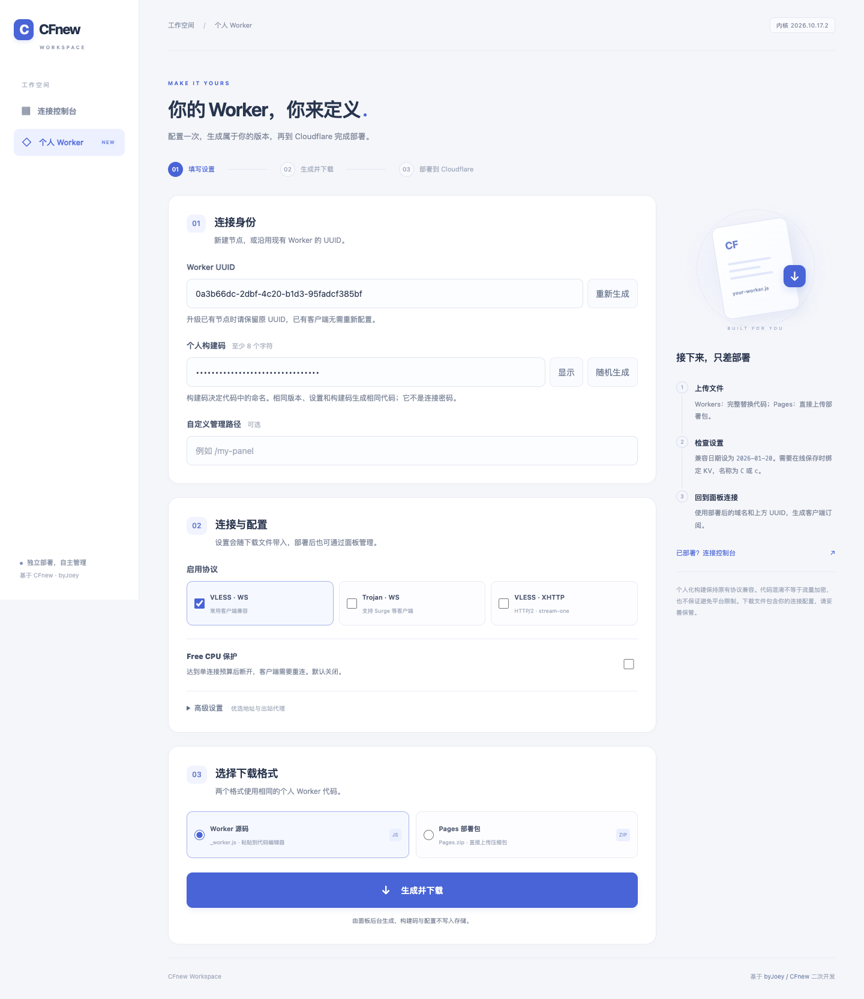

# CFTWO-Panel

[](https://vercel.com/new/clone?repository-url=https%3A%2F%2Fgithub.com%2Fhanhaoops%2FCFTWO-Panel&project-name=cftwo-panel&repository-name=cftwo-panel)
[](https://nodejs.org/)
[](./LICENSE)

## 简介

CFTWO-Panel 是一个独立面板，提供连接管理、配置管理、优选地址和客户端订阅功能。面板可以运行在 Vercel、Docker 或自有服务器上；代理数据直接在用户的 Cloudflare Worker 与客户端之间传输，不经过面板。

在线地址：[https://cf2panel.vercel.app/](https://cf2panel.vercel.app/)



## 个人 Worker

每个用户都可以在面板首页打开“个人 Worker”，填写自己的 UUID、个人构建码和连接设置，然后下载属于自己的 `_worker.js` 或 `Pages.zip`。下载后在 Cloudflare Dashboard 中创建自己的 Worker 或 Pages 项目并上传文件，再用部署后的域名回到面板连接。

个人构建会为不同构建码生成不同的代码命名和版本结果，同时保留原有协议、订阅格式、KV 配置和客户端兼容性。构建码与下载文件不会写入面板存储。生成文件不包含项目说明、来源地址或构建注释；代码混淆用于构建差异和源码整理，不是流量加密，也不保证规避平台规则或滥用判断。

已经部署的用户可以在控制台点击“用已保存配置生成”，将当前 Worker 的配置带入构建页。这样可以保留原 UUID，再生成自己的新版本。

## 一键部署

点击顶部按钮后，Vercel 会创建一个私有 GitHub 仓库并部署独立面板。按钮使用小写的 `cftwo-panel` 作为默认项目名和仓库名，符合 GitHub 命名习惯。若希望每次使用不同的私有仓库名，可在 Vercel 创建页面把 **Private Repository Name** 改成类似 `cftwo-panel-7m4k` 的随机小写名称。

部署时选择 **Other**（旧界面叫 Framework），根目录保持仓库根目录，不需要填写额外构建命令。部署完成后打开分配的域名，进入个人 Worker 页面或连接已有 Worker。

如果 Vercel 提示需要 GitHub 授权，请先在 Vercel 的 Authentication → Sign-in Methods 连接 GitHub。订阅客户端需要访问公开的面板域名；如果被 Vercel 登录保护拦截，请在 Deployment Protection 中调整设置。

## 固定一个面板只管理指定 Worker

在 Vercel 项目的 Settings → Environment Variables 中设置小写变量 `w`，填 Worker 的 HTTPS 根地址，例如 `https://your-worker.example.com`，然后重新部署。留空时是公共面板，可以连接任意兼容 Worker；设置后只接受这个 Worker。

`w` 只限制面板接入对象，不代替 UUID 验证，也不会隐藏 Worker 的网络路径。不要在值中加入 UUID、路径、查询参数或账号密码。

## 连接与订阅

首页连接已有 Worker 时填写域名和 UUID 或自定义路径。常用入口如下：

```text
控制台：https://面板域名/你的UUID
订阅：  https://面板域名/你的UUID/sub
Clash： https://面板域名/你的UUID/sub?target=clash
```

如果 Worker 的 `d` 是 `/Admin/Panel`，也可以使用该路径进入。大小写必须一致。支持 base64、v2ray、clash、stash、singbox、surge、loon 和 quanx 格式；开启家宽链式后可使用 `target=vg`。

## 配置与 Free CPU 保护

在线保存配置时，在 Cloudflare Worker 中绑定 KV，变量名称使用 `C` 或 `c`。没有 KV 时仍可以读取环境变量并生成订阅，但面板不能保存修改。

配套内核兼容日期为 `2026-01-20`。配置管理中的 Free CPU 保护默认关闭；开启后按单连接的数据量和数据块预算提前断开，客户端需要重连，下载和视频可能中断。这是资源保护估算，不能保证所有免费账号都不会超限。

## 自有服务器与 Docker

Node.js 22：

```bash
git clone https://github.com/hanhaoops/CFTWO-Panel.git
cd CFTWO-Panel
npm ci
npm start
```

默认监听 `127.0.0.1:3100`，可以使用 Nginx 或 Caddy 反代并启用 HTTPS。固定 Worker 时设置 `w=https://your-worker.example.com`。

Docker：

```bash
docker compose up -d --build
```

Docker、Node、Vercel 使用同一套面板代码和个人 Worker 构建功能。

## 开发与验证

```bash
npm ci
npm test
npm run build:vercel -- /一个空目录
```

测试使用内存 KV 与本地隔离 Worker，不访问真实节点。`CFNEW_ALLOW_PRIVATE=yes` 仅供隔离测试，线上不要设置。

## 来源与许可

CFTWO-Panel 基于 CFnew 及其相关开源项目进行二次开发，来源与第三方许可见 [NOTICE.md](./NOTICE.md)。本仓库采用自定义的 [CFnew 源码使用与署名许可](./LICENSE)，允许合法修改和二次开发，但不得将改写结果冒充为无关的原创项目。

本项目供学习与网络技术研究，请遵守当地法律及所用平台的服务条款。
